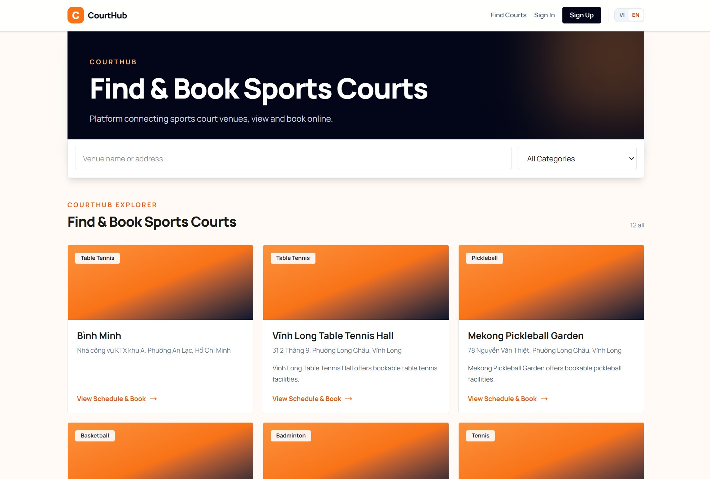

  
  
  
  
  
  
  
  
  

# CourtHub

CourtHub is an online sports court booking platform that helps customers find suitable courts, check real-time availability, and reserve a time slot in a few simple steps.

The platform connects people who want to play sports with sports venue partners. Customers can discover venues and book courts, while partners can publish and operate their own venues through a dedicated management workspace. CourtHub is available online at [courthub.io.vn](https://courthub.io.vn).

## Product Highlights

- Search approved sports venues by name, address, city, or sport category.
- Browse venue information, courts, pricing slots, and availability by date.
- Select one or more consecutive available time slots through an interactive schedule.
- Book as a guest with contact information or sign in to keep a personal booking history.
- Complete online payments through PayOS.
- Reopen an unpaid payment session when the payment page is closed or the customer returns later.
- Automatically expire unpaid bookings after the payment window ends.
- View booking history, payment status, booking time, venue, court, and contact details.
- Sign in with email, phone number, or Google OAuth.
- Reset a forgotten password securely through an email link delivered by Resend.
- Allow customers to request partner access from their profile.

## For Venue Partners

Partners can manage their business directly from CourtHub:

- Create and update venue information, including category and Vietnamese province or ward details.
- Add, edit, activate, deactivate, or soft-delete courts.
- Configure independent pricing slots for each day of the week.
- Copy pricing rules across multiple weekdays to reduce repetitive work.
- Review bookings in a date-filtered schedule.
- Monitor courts and availability from an overview dashboard.

CourtHub prevents invalid reservations by validating court activity, venue approval, pricing rules, operating availability, slot alignment, and overlapping bookings on the server before a booking is confirmed.

## Customer Experience

Customers can use CourtHub without needing to create an account. Guest bookings require contact information so the venue can identify and serve the customer. Registered customers receive a richer experience with saved profile information, Google sign-in, booking history, payment status tracking, and secure password recovery.

The interface supports Vietnamese and English, responsive layouts, debounced venue search, category filters, infinite scrolling, interactive availability charts, and clear status feedback for booking and payment actions.

## User Roles

### Guest

Guests can browse venues and create bookings by providing contact information. They do not need an account, but they cannot access a persistent booking history.

### Customer

Customers can register, sign in, book courts, pay online, view booking history, cancel eligible bookings, and request to become a venue partner.

### Partner

Partners can manage their venues, courts, weekday pricing, and bookings through the partner dashboard.

### Administrator

Administrators manage users, partner requests, venues, categories, and system-wide bookings.

## Production Deployment

CourtHub has been deployed as a complete production system and is available at:

**[https://courthub.io.vn](https://courthub.io.vn)**

The frontend and backend are deployed as separate applications with a production PostgreSQL database, HTTPS, authentication cookies, Google OAuth, email delivery, online payments, and payment status synchronization configured for the live domain.

## Demo Accounts

The following accounts are available for exploring the customer and partner experiences.

| Role | Email | Password |
| --- | --- | --- |
| Customer | `customer@example.com` | `courthub@123` |
| Partner | `partner@example.com` | `courthub@123` |

For security, the administrator account is not published as a public demo credential.
